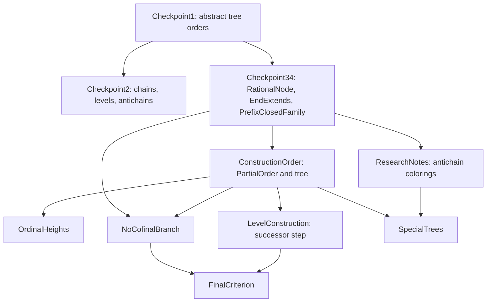

# Aronszajn Trees in Lean 4

Final project for **21-321 Interactive Theorem Proving** (Carnegie Mellon, Fall 2026), by Arshia Dabas.
This was an individual project.

An *Aronszajn tree* is a tree of height ω₁ with countable levels and no uncountable branch. Its
existence shows that the tree property fails at ω₁. This project formalizes the classical
rational-sequence construction (Jech, *Set Theory*, Theorem 9.16): nodes are strictly increasing,
ordinal-indexed sequences of rationals, ordered by end-extension.

## Status

**What is proved.** The ambient tree of rational sequences is a tree order; no chain in it can
reach ω₁ (so the "no uncountable branch" condition holds for every selected subfamily); the
successor step of the construction works while keeping room below a rational bound; and a
conditional criterion reduces the whole existence theorem to one extension property.

**What is not proved.** The existence of an Aronszajn tree itself. The missing piece is choosing
a prefix-closed family with countable levels at every countable ordinal, in particular at
*limit* stages, where the extension property `HasExtensionInvariant` has to be established.
The report explains why this step is not another successor step (a sequence such as
0, ½, ¾, ⅞, … has room below 1 at every finite stage but not at its limit).

The project builds with no errors and contains no `sorry`.

## Main results

| Result | Lean name | File |
|---|---|---|
| Heights increase along the order; same-level nodes are incomparable | `nodeHeight_lt_of_lt`, `same_level_not_lt` | `Checkpoint1` |
| Levels are antichains; a chain meets a level at most once | `level_isAntichain`, `chain_meets_level_at_most_once` | `Checkpoint2` |
| A rational specialization makes every chain countable | `countable_chain_of_rational_specialization` | `Checkpoint2` |
| Every rational node has countably many indices | `rationalNode_domain_countable` | `Checkpoint34` |
| Two initial segments of a node are comparable | `initialSegments_comparable` | `Checkpoint34` |
| End-extension is antisymmetric, giving a `PartialOrder` | `endExtends_antisymm` | `ConstructionOrder` |
| Rational sequences under end-extension form a tree | `rationalNodes_form_tree` | `ConstructionOrder` |
| An initial segment is determined by its length | `initialSegments_eq_of_length_eq` | `OrdinalHeights` |
| **No chain is cofinal in ω₁** | `ambient_no_cofinal_chain` | `NoCofinalBranch` |
| Every selected family has no cofinal chain | `selected_family_no_cofinal_chain` | `NoCofinalBranch` |
| **Successor step with room below `q`** | `successor_extension_with_room` | `LevelConstruction` |
| The extension invariant gives nonempty levels | `nonempty_levels_of_extension_invariant` | `LevelConstruction` |
| **Conditional Aronszajn criterion** | `aronszajn_of_extension_invariant` | `FinalCriterion` |
| Antichain colorings give countable chains | `chain_countable_of_antichain_coloring` | `SpecialTrees` |
| An uncountable special family is not Suslin-like | `uncountable_special_not_suslin` | `SpecialTrees` |

## How the files fit together



A good reading order is `Checkpoint1`, `Checkpoint34`, `ConstructionOrder`, `NoCofinalBranch`,
`LevelConstruction`, `FinalCriterion`. The `Checkpoint*` files are named after the course
checkpoints in which they were written; the later files are named by topic.

## Some design notes

- **Nodes.** `RationalNode` stores an ordinal length and a strictly increasing map from
  `{i // i < length}` to ℚ. This rules out out-of-range evaluations by construction, at the cost
  of dependent-type bookkeeping in equality proofs (see `endExtends_eq_of_length_eq`).
- **Order.** End-extension is installed as a `PartialOrder` instance so Mathlib's order API
  applies directly. Well-foundedness comes from pulling back `<` on `Ordinal` along `length`.
- **Specification vs. construction.** Predicates such as `HasExtensionInvariant` and
  `HasCountableSelectedLevels` only *state* the properties the final family needs. They are
  labelled as specifications in the source because defining one does not give an example.
- **Heights.** `Checkpoint1` defines height through `WellFounded.rank`; the concrete model uses
  ordinal length. Proving that the two agree (an order isomorphism between the predecessors of a
  node and the ordinals below its length) is not done; `OrdinalHeights.lean` proves the first step.

## Building

```bash
lake exe cache get   # download the prebuilt Mathlib
lake build
```

Lean and Mathlib are pinned to `v4.36.0-rc1` (`lean-toolchain`, `lakefile.toml`). The build
prints style-linter warnings (file headers, `module`); they are harmless. Continuous
integration runs `lake build` on every push (`.github/workflows/lean_action_ci.yml`).

## Other deliverables

- Written report: [`report/`](report/) (LaTeX source and PDF)
- [`COLLABORATION.md`](COLLABORATION.md)
- [`AI_USE.md`](AI_USE.md)

## Reference

T. Jech, *Set Theory: The Third Millennium Edition, Revised and Expanded*, Springer, 2003.